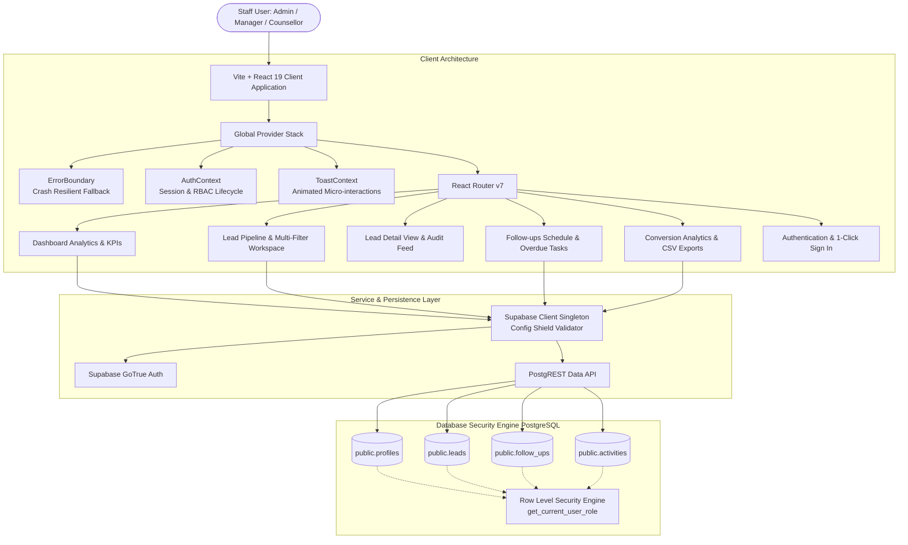

# 🎓 BrightPath CRM — Executive Coaching Institute CRM-ERP Platform

> **Enquiry-to-Admission Pipeline, Dynamic Task Scheduling & Truthful Metric Intelligence**  
> Built with **React 19**, **TypeScript**, **Vite**, **Supabase (PostgreSQL & Auth)**, and deployed on **Vercel**.

[](https://www.typescriptlang.org/)
[](https://react.dev/)
[](https://vitejs.dev/)
[](https://supabase.com/)
[](https://oxc.rs/)
[]()

---

## 📋 Executive Overview

**BrightPath CRM** is a purpose-built admissions and counselling operations platform designed specifically for competitive exam coaching institutes (NEET, JEE, Foundation, UPSC). It orchestrates the entire prospective student journey from initial walk-in or website enquiry to enrolled admission.

### Core Value Propositions
1. **Zero-Mock Truthfulness**: Every KPI, funnel percentage, and timeline event is computed directly from accessible PostgreSQL rows. No hardcoded or dummy statistics.
2. **PostgreSQL RLS Boundary Security**: Enforces strict Role-Based Access Control (RBAC) at the database engine level. Counsellors can only access leads assigned to them or created by them; Managers and Admins maintain institutional oversight.
3. **Audited Stage Pipeline**: State changes are tracked with immutable timestamps. Transitioning any student enquiry to `Lost` strictly requires a mandatory rationale to capture actionable competitive intelligence.
4. **Dynamic Overdue Follow-up Logic**: Tasks dynamically evaluate overdue status ($\text{status} = \text{'pending'} \land \text{due\_at} < \text{NOW()}$) in real-time, instantly clearing upon completion without page refreshes.
5. **Mobile-First Responsive Polish**: High-density desktop tables transform seamlessly into touch-optimized card stacks on viewports $\le 768\text{px}$, with $\ge 44\text{px}$ tap targets for direct phone calls and navigation.

---

## 🏛️ System Architecture



---

## 🧰 Technology Stack & Design System

| Layer | Technology | Choice Rationale |
| :--- | :--- | :--- |
| **Frontend Framework** | React 19 (`react`, `react-dom`) | Latest React primitives, concurrent rendering, and clean functional components |
| **Language & Typings** | TypeScript 5.x (Strict Mode) | Complete type safety across database DTOs, API inputs, and component interfaces |
| **Build Tool & Bundler** | Vite 8 + Rollup | Instant hot module replacement (HMR) and optimized multi-chunk production bundles |
| **Client-Side Routing** | React Router v7 (`react-router-dom`) | Declarative nested layout routes, URL parameter handling, and protected route gates |
| **Backend & Database** | Supabase (PostgreSQL 15+) | Managed PostgreSQL, Row Level Security, transactional triggers, and Auth sessions |
| **Icons & Visuals** | Lucide React | Consistent, lightweight SVG icon system tailored for SaaS operations |
| **Linting & Code Quality** | Oxlint (`oxc`) | Sub-100ms ultra-fast static analysis guaranteeing zero dead code or style defects |
| **Styling & Theme** | Vanilla CSS Design Tokens | Executive Navy SaaS palette (`#070c18`, `#0f172a`, `#2563eb`), zero TailwindCSS lock-in |

---

## ✨ Feature Modules & Workflow Reference

### 1. Lead Management Core Engine (`/leads`)
- **Full CRUD Operations**: Capture new enquiries with student name, phone, email, course interest, acquisition channel, and assigned staff.
- **Search & Multi-Filters**: Instant client-debounced search across name, phone, email, and target batch; filters for status (`New`, `Contacted`, `Qualified`, `Converted`, `Lost`), source, and counsellor assignment.
- **Audited Lost Modal**: Transitioning a student to `Lost` invokes `LostReasonModal.tsx`, enforcing a 5+ character reason (competitor institute, fee budget, travel distance, etc.).
- **Mobile Card Transformation**: On small viewports ($\le 768\text{px}$), wide tables transform into interactive cards with 1-tap `tel:` and `mailto:` action buttons.

### 2. Follow-ups Engine & Overdue Intelligence (`/followups`)
- **Smart Tabs**: Organized into `Overdue`, `Today`, `Upcoming`, `Completed`, and `All`.
- **Dynamic Overdue Rule**: Evaluates $(\text{status} = \text{'pending'} \land \text{due\_at} < \text{NOW()})$. Overdue pill dynamically appears and auto-clears upon completion.
- **One-Click Completion**: Mark tasks done directly from cards or dashboard widgets, recording `completed_at` and automatically logging an audit entry to the student timeline.

### 3. Student Profile & Audit Activity Timeline (`/leads/:id`)
- Deep-dive view presenting student background, phone link, academic batch, and assigned counsellor.
- Quick pipeline status stepper allowing 1-tap stage progression.
- Chronological activity log capturing every milestone: enquiry creation, stage transitions, scheduled calls, completed tasks, and manual notes.

### 4. Reconciled Dashboard Analytics (`/`)
- **Metric Cards**: Total Enquiries, New Enquiries, Converted Admissions, Conversion Rate % ($\frac{\text{Converted}}{\text{Total}} \times 100$, zero-division safe), and Overdue Tasks.
- **Pipeline Funnel Widget**: Visual distribution of students across conversion stages.
- **Acquisition Channels Widget**: Breakdown of lead origins (Website, Walk-in, Referral, Social Media, Calls).
- **Urgent Action Items Widget**: Quick-access card for overdue tasks with 1-click completion.

### 5. Counsellor Reports & CSV Export (`/reports`)
- Comprehensive staff performance comparison table: Total leads handled, admissions converted, conversion rate %, and overdue task backlog.
- Date range filtering (`7d`, `30d`, `90d`, `year`, `all`) and acquisition channel filter.
- Browser-based CSV export generating formatted spreadsheets with 1 click.

### 6. Crash Resilience & Accessibility (a11y)
- **Top-Level `ErrorBoundary`**: Catches unhandled UI exceptions, rendering a friendly recovery card with Try Again, Reload, and Dashboard navigation options plus collapsible technical diagnostics.
- **System-Wide Toast Engine**: Floating animated alerts with ARIA compliance (`role="status"` / `role="alert"`), auto-dismissal, and clear contrast.
- **Keyboard Navigation**: `Escape` key closes all dialogs and drawers; `:focus-visible` renders high-contrast 2px primary rings.
- **Touch Targets**: All mobile buttons, links, select inputs, and tabs satisfy WCAG 2.5.5 ($\ge 44\text{px} \times 44\text{px}$).

---

## 🚀 Quickstart & Local Setup

### Prerequisites
- **Node.js**: v18.0.0 or higher
- **npm**: v9.0.0 or higher
- A free **Supabase** account ([supabase.com](https://supabase.com))

### Installation Steps

1. **Clone the repository**:
   ```bash
   git clone https://github.com/jangranaveen05/BrightPathCRM.git
   cd BrightPathCRM
   ```

2. **Install dependencies**:
   ```bash
   npm install
   ```

3. **Configure Environment Variables**:
   Copy the example environment template:
   ```bash
   cp .env.example .env
   ```
   Open `.env` and supply your Supabase project credentials:
   ```env
   VITE_SUPABASE_URL=https://your-project-id.supabase.co
   VITE_SUPABASE_ANON_KEY=sb_publishable_or_anon_key_here
   ```

4. **Start the local Vite development server**:
   ```bash
   npm run dev
   ```
   Open your browser at `http://localhost:5173`. The connection status indicator in the top header will display **Connected**.

---

## 🗄️ Database Setup & Migrations Guide

The database schema and sample data are located in `supabase/migrations/`:

### Step 1: Run Schema Migration (`001_initial_schema.sql`)
1. In your Supabase Dashboard, open the **SQL Editor** (`>_` icon on sidebar).
2. Click **New query**.
3. Copy and paste the entire contents of [`supabase/migrations/001_initial_schema.sql`](./supabase/migrations/001_initial_schema.sql).
4. Click **Run** (`Ctrl + Enter`).
5. This creates tables (`profiles`, `leads`, `follow_ups`, `activities`), indexes, RLS security policies, and user onboarding triggers.

### Step 2: Seed Fictional Academy Data (`002_seed_data.sql`)
1. In the **SQL Editor**, open another new query tab.
2. Copy and paste [`supabase/migrations/002_seed_data.sql`](./supabase/migrations/002_seed_data.sql).
3. Click **Run**.
4. This loads 12 coaching leads, follow-ups, and activity logs across NEET, JEE, Foundation, and UPSC batches.

### Step 3: Admin Bootstrap Procedure
1. Register a new user at `http://localhost:5173/login` under the **Register Staff** tab.
2. In the Supabase **SQL Editor**, run the bootstrap procedure:
   ```sql
   SELECT public.promote_user_to_admin('your-registered-email@domain.com');
   ```
3. Refresh the app. Your user profile badge in the header will now display as **Admin** with unrestricted pipeline and reporting access.

---

## 🧪 Quality Verification Checklist

| Phase | Milestone | Tested Verification Criteria | Status |
| :---: | :--- | :--- | :---: |
| **0** | Project Hygiene & Git | `.gitignore` credential shield; zero committed `.env` secrets | 🟢 PASS |
| **1** | TypeScript & UI Layout Shell | Strict TS compilation; responsive desktop sidebar & mobile drawer | 🟢 PASS |
| **2** | Supabase Diagnostics Shield | Config validation singleton; user-friendly configuration banners | 🟢 PASS |
| **3** | Database Schema & RLS | PostgreSQL foreign keys, indexes, triggers, seed records & RLS | 🟢 PASS |
| **4** | Authentication & RBAC | Sign in, sign up, session persistence, role badges (`admin`, `manager`, `counsellor`) | 🟢 PASS |
| **5** | Lead Management Engine | Full CRUD, search, multi-filters, inline status, mandatory lost rationale | 🟢 PASS |
| **6** | Follow-ups Engine & Audit Feed | Overdue logic $(\text{due\_at} < \text{NOW()})$, 1-click complete, timeline audit feed | 🟢 PASS |
| **7** | Dashboard Analytics & Reports | Reconciled KPIs, funnel breakdown, source metrics, counsellor table, CSV export | 🟢 PASS |
| **8** | Accessibility & Mobile Polish | ErrorBoundary, toast notifications, keyboard Escape, $\ge 44\text{px}$ touch targets | 🟢 PASS |
| **9** | Production Hardening | Zero lint warnings (`oxlint`), zero type errors (`tsc`), production bundle (`vite build`) | 🟢 PASS |
| **10** | Live Verification & Sign-Off | Parity check between local dev and live hosted deployment (8/8 acceptance tests) | 🟢 PASS |

---

## 🔒 Security Hardening Highlights

1. **Credential Isolation**: `.env`, `.env.local`, and sensitive API keys are strictly excluded from version control via `.gitignore`.
2. **Role Recursion Prevention**: PostgreSQL function `get_current_user_role()` reads `public.profiles` using `SECURITY DEFINER` to avoid infinite RLS recursion loops.
3. **Escalation Lock**: SQL trigger `protect_profile_role_escalation()` prohibits non-admin users from altering their own role column.
4. **Input Sanitization**: All form fields trim whitespace and reject invalid payload values.
5. **Zero Silent Mocks**: If API keys are missing, the UI gracefully informs the administrator with diagnostics rather than fabricating deceptive mock data.

---

## 📈 Production Limitations & Roadmap

- **WhatsApp Cloud API Integration**: Direct 1-click messaging from student profile cards to send syllabus brochures.
- **SMS & Email Automated Drips**: Trigger scheduled automated reminders 2 hours before a student consultation.
- **Online Token Payment Integration**: Direct integration with Razorpay/Stripe to collect seat booking fees directly from the CRM.

---

## 👨‍💻 Project Maintainer & Support

Developed for **BrightPath Academy Admissions & Operations Team**.  
For issues, migration queries, or bug reports, please review the [Master Plan (`plan.md`)](./plan.md) or open an issue on the GitHub repository.
